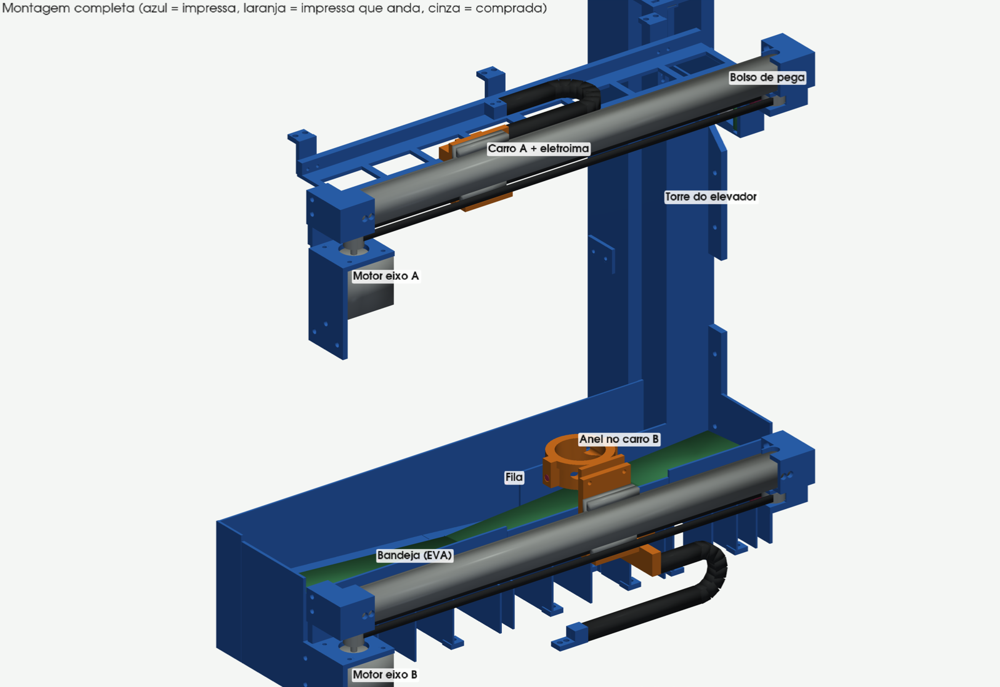

# PICBOX – Máquina A (bolinha)

Duas versões da mesma máquina, cada uma na sua pasta.

| Pasta | O que é |
|---|---|
| [`compacta/`](compacta/LEIA-ME.md) | **Versão atual (R2.2).** Cabe no gabinete de 440 × 430 × 230 com a tela no fundo, bola de aço de 1". É a que está sendo impressa e montada. |
| [`normal/`](normal/LEIA-ME.md) | Versão original: gabinete de 450 × 450 × 1700, bola de 38 mm. CAD das peças, documentos de projeto, visão geral em imagens e o simulador do site. |

## Para imprimir a compacta

Leia `compacta/imprimir/LEIA-ME_R2.txt` (o que mudou e o que comprar) e depois `compacta/imprimir/ORDEM_DE_IMPRESSAO.txt`. Cada impressora tem a sua pasta, com as mesas numeradas na ordem:

- `compacta/imprimir/A_impressora_grande/`
- `compacta/imprimir/B_creality_1/`
- `compacta/imprimir/C_creality_2/`
- ou tudo numa impressora só: `compacta/imprimir/SparkX_i7/`

Peças pequenas da polia de cima do elevador (R2.2): `compacta/imprimir/polia_de_cima/`.

## Para montar e entender

Abra no navegador (arquivo único, dá para enviar):

| Página | O que mostra |
|---|---|
| `compacta/pagina/PICBOX_elevador_montagem.html` | Montagem do elevador em 15 passos, com as peças entrando no lugar. |
| `compacta/pagina/PICBOX_elevador_3D.html` | Elevador em 3D com os nomes e a cabine subindo e descendo. |
| `compacta/pagina/PICBOX_compacta_visualizacao.html` | Máquina inteira: 3D, peças, montagem, cabos, firmware e checagens. |
| `compacta/pagina/PICBOX_R2_visualizador_3D.html` | Cada peça, onde fica na mesa de impressão e em que passo entra. |
| `compacta/pagina/PICBOX_como_funciona.html` | Como funciona, animado. |

## Observações

- O site no ar (Railway) é publicado do ramo `main`, que não mudou. Neste ramo (`cad-pecas`), o site fica em `normal/simulacao/`. Não junte este ramo no `main` sem antes ajustar o `railway.json`.
- `CLAUDE.md` traz as instruções para o assistente.
