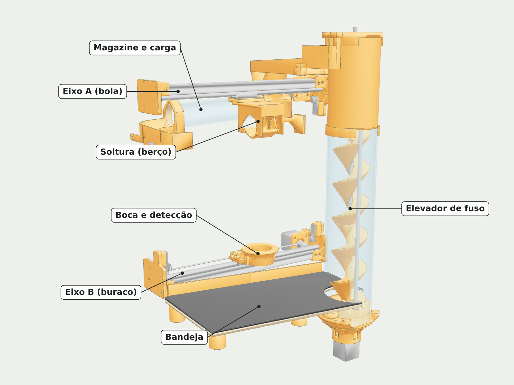
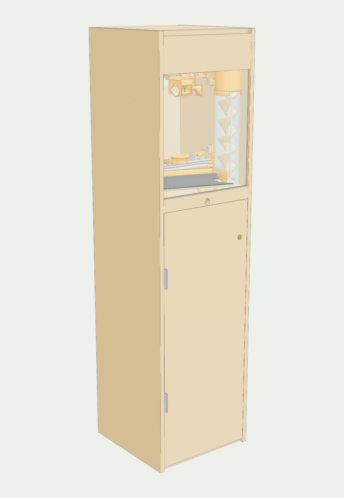
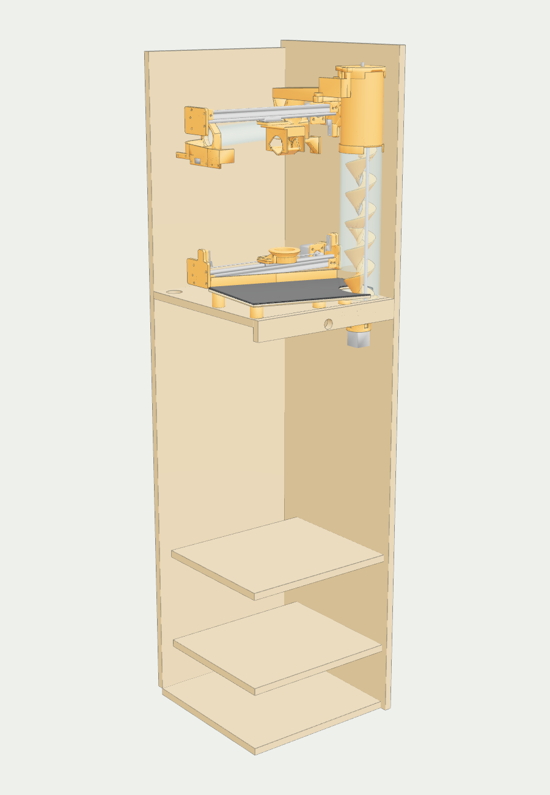
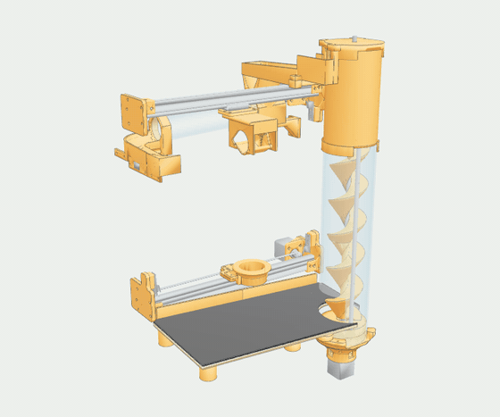
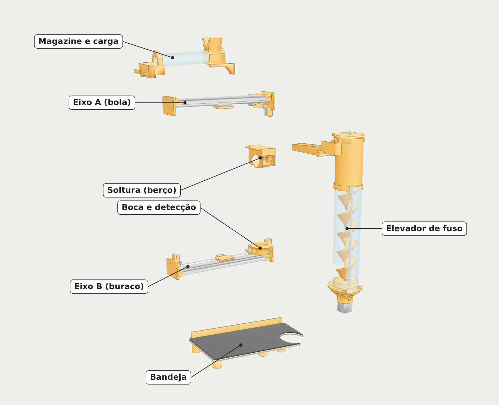
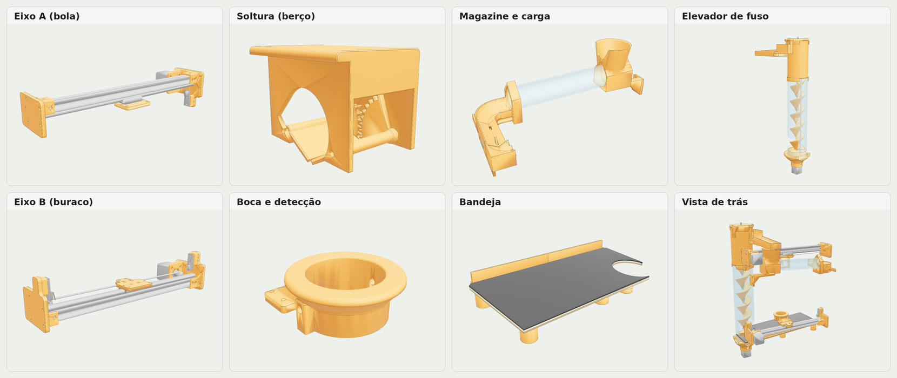

# PICBOX — simulação e engenharia

Máquina de arcade de habilidade (timing) com prêmio físico: dois eixos lineares se movem um acima do outro —
o **eixo A** leva a **bola**, o **eixo B** leva o **buraco** — e o jogador escolhe a hora de soltar a bola.

Este repositório reúne tudo o que define a máquina:

| Parte | O que é | Onde |
|---|---|---|
| **Simulador** | Física do voo, probabilidade de acerto, economia, Monte Carlo e modelo 3D paramétrico (Three.js). É o site publicado. | `index.html`, `modelo3d.html`, `js/`, `css/` |
| **Montagem guiada** | Página com os módulos da máquina, passo a passo de montagem e lista de compras. | `montagem.html`, `montagem/` (gerado por `cad/`) |
| **CAD das peças (Máquina A)** | Peças impressas reais em CadQuery (B-rep): STEP, STL na posição de impressão, 13 verificações automáticas por peça. | `cad_pecas/` |
| **Documentação** | Produto e decisões, engenharia, especificação do CAD. | `docs/` |

> Projeto confidencial. O repositório é privado, mas o site publica a pasta inteira (`npx serve .`): o CAD de
> fabricação fica no ramo `cad-pecas` até o deploy servir só os arquivos do site (ver "Publicação").

## A máquina A inteira

<p align="center">
  
</p>

| Gabinete fechado | Gabinete aberto |
|:---:|:---:|
|  |  |
| 450 × 450 × 1700 mm, MDF 18 | campo de jogo em cima; o pedestal fica para fonte e eletrônica |

O gabinete vem do CAD antigo (`../montagem/modelos`) e entra só como contexto. Todo o resto é o CadQuery de
`cad_pecas/`: as 39 peças impressas (42 unidades), as compradas e a bandeja.

**Em movimento** (sem gabinete):

<p align="center"></p>

**Vista explodida** (cada módulo afastado da posição real):

<p align="center"></p>

**Módulo a módulo:**

<p align="center"></p>

Para girar e clicar nas peças, abra `cad_pecas/saidas/visualizador.html`. As imagens acima saem de
`cad_pecas/ferramentas/visao_geral/gerar.py`; rode de novo depois do `build_all.py` quando o CAD mudar.

## Comece por aqui

- **Ver as peças montadas:** abra `cad_pecas/saidas/visualizador.html` no navegador (dois cliques, sem servidor).
  Lista de peças ao lado; clicar destaca a peça na máquina; modo "peça a peça"; links para STL e STEP.
- **Montar:** [`cad_pecas/docs/MONTAGEM.md`](cad_pecas/docs/MONTAGEM.md) — passo a passo da Máquina A, com imagens,
  parafusos e o que conferir em cada etapa.
- **Imprimir:** `cad_pecas/saidas/stl_para_imprimir/<grupo>/` — já na orientação de impressão.
  Ordem e tempos em `cad_pecas/docs/FILA_IMPRESSAO.md`; parafusos em `cad_pecas/docs/BOM_FIXACAO.md`.
- **Abrir em CAD:** `cad_pecas/saidas/montagem/maquina_a_montada.step` (tudo junto, sem gabinete) ou
  `cad_pecas/saidas/step/<grupo>/` (peça a peça, na posição de montagem).
- **Entender as decisões:** `docs/PROJETO.md` (produto) e `docs/ENGENHARIA.md` (técnico);
  do CAD: `cad_pecas/docs/CHANGELOG.md` e `cad_pecas/docs/PENDENCIAS.md`.

## Estrutura

```
.
├── index.html, modelo3d.html, montagem.html   site (simulador e montagem guiada)
├── js/, css/                                  código do simulador
├── montagem/                                  modelos e arquivos da montagem guiada (gerados por cad/)
├── cad/                                       CAD antigo em JS (replicad): gera montagem/ — só referência de posição
├── cad_pecas/                                 CAD das peças impressas (Python/CadQuery) — ver cad_pecas/README.md
│   ├── maquina_a/        geometria compartilhada (layout, eixos, soltura, magazine, bandeja, elevador)
│   │   └── pecas/        uma peça por arquivo: A01_bloco_motor.py … A27_cabeca_elevador.py
│   ├── common/           tolerâncias de fabricação, features, compradas, checagens, render
│   ├── ferramentas/      build completo, relatórios, visualizador, imagens explicativas, diagnóstico
│   ├── docs/             inventário, pendências, verificação, fila de impressão, BOM, changelog
│   └── saidas/           arquivos gerados (STL, STEP, montagem, imagens, relatórios, visualizador)
├── docs/                 PROJETO.md, ENGENHARIA.md, ESPECIFICACAO_CAD_PECAS.md
└── package.json, serve.json, railway.json      deploy do site (Railway)
```

## Rodar

```bash
npm install && npm start                       # site em http://localhost:3000
```

```bash
python -m venv .venv                           # CAD (uma vez, na raiz)
.venv/Scripts/pip install cadquery trimesh numpy pyvista manifold3d rtree scipy networkx
cd cad_pecas && ../.venv/Scripts/python ferramentas/build_all.py
```

## Convenções

- Unidade mm. CAD com Z para cima, X à direita do jogador, Y para o fundo; origem no centro do piso.
- Toda cota tem procedência (`PARAMS`, `CENA`, `CATALOGO`, `MEDIDO`, `FAB`, `ESTIMADO`); `ESTIMADO` precisa de
  medição na bancada e está listado em `cad_pecas/docs/PENDENCIAS.md`.
- Ramo `main`: site publicado. Ramo `cad-pecas`: CAD das peças (não publicar).

## Publicação

O Railway sobe o ramo `main` com `npx serve .`, que serve **qualquer arquivo** do repositório. Antes de juntar
`cad-pecas` na `main`, mova o site para uma pasta própria (ex.: `site/`) e troque o comando para
`npx serve site -l $PORT`, ou bloqueie `cad_pecas/` e `docs/` no `serve.json`.
