# PICBOX — Máquina A: guia de montagem

Montagem passo a passo das peças impressas da Máquina A, na ordem em que uma etapa não atrapalha a seguinte.
Cada etapa diz **o que imprimir**, **o que comprar**, **quais parafusos** usar e **o que conferir** antes de seguir.

- Arquivos de impressão: `../saidas/stl_para_imprimir/<grupo>/` (já na orientação certa). Ordem e tempos em
  [FILA_IMPRESSAO.md](FILA_IMPRESSAO.md); parafusos de cada peça em [BOM_FIXACAO.md](BOM_FIXACAO.md).
- Para ver onde cada peça fica, abra `../saidas/visualizador.html` e clique na peça.
- Medidas marcadas como estimadas e testes de bancada estão em [PENDENCIAS.md](PENDENCIAS.md). **Leia a etapa 0
  antes de imprimir as peças que dependem de medida real.**

## Como ler este guia

- **Frente** = lado do jogador. **Esquerda** e **direita** são vistas de frente para a máquina.
- **Eixo B** (embaixo, z = 1175) leva o **buraco** (boca). **Eixo A** (em cima, z = 1530) leva a **bola** (berço).
- No eixo, o **motor** fica sempre na ponta **direita** e o **tensor** na ponta **esquerda**.
- Todas as peças são PETG. Peças "estruturais" com 40% de preenchimento; o resto com 20%, salvo indicação.

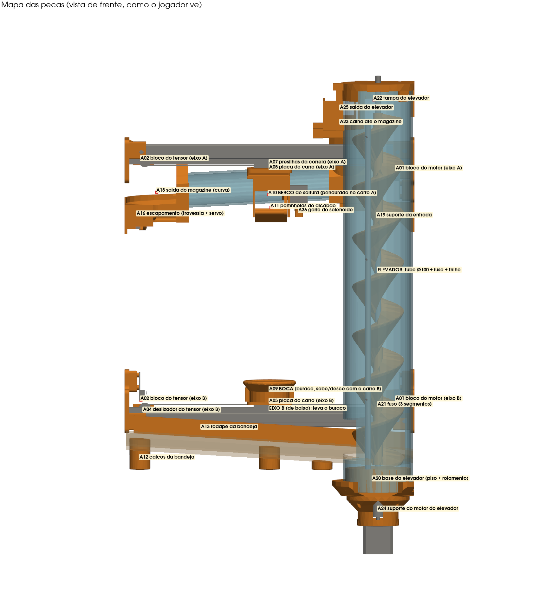

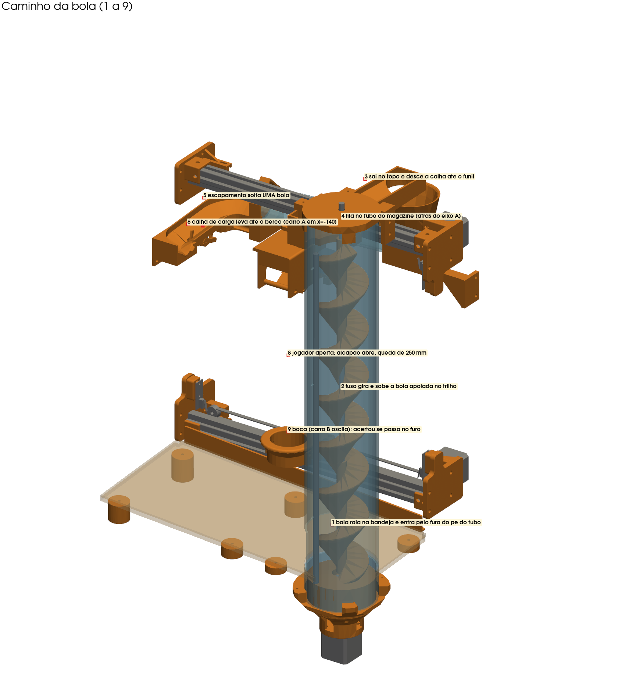

---

## Etapa 0 — Antes de começar

### Medir antes de imprimir

Algumas peças foram desenhadas com medidas estimadas. Meça as peças compradas e, se algo for diferente, ajuste o
CAD **antes** de imprimir a peça correspondente:

| Medir | Valor usado no CAD | Afeta |
|---|---|---|
| Solenoide JF-0826B: corpo, furos M3, Ø do êmbolo, curso | 25 × 22 × 27 mm; furos a 8,5 e 18,5 mm da face do êmbolo; Ø7,4; 10 mm | A10, A36 |
| Força da mola de retorno do solenoide (desligado) | precisa segurar ~0,8 N (80–100 g) | soltura |
| Servo SG90 e o braço do kit | corpo 22,8 × 12,2 × 22,7; braço Ø7,4 + 5,4 × 17 × 1,8 | A16, A17 |
| Módulo de fim de curso | placa 40 × 16, furos a −16/+2 mm do centro | A01, A02 |
| Tubos acrílicos (Ø externo real) | Ø50 × 44 (magazine); Ø100 × 94 (elevador) | A15, A18, A20, A27 |

### Comprar

| Item | Quantidade | Onde vai |
|---|---|---|
| Trilho MGN12 400 mm + patim MGN12H | 2 + 2 | eixos A e B |
| Perfil 2020 400 mm | 2 | eixos |
| NEMA 17 (17HS4401) + driver | 3 | eixos A e B + elevador |
| Polia GT2 20T furo 5 | 2 | eixos |
| Polia tensora GT2 20T com rolamento | 2 | eixos |
| Correia GT2 6 mm | 2 m | eixos (≈ 790 mm cada) |
| Módulo de fim de curso mecânico | 3 | 2 no eixo B, 1 no eixo A |
| Solenoide JF-0826B (puxar) | 1 | berço |
| Servo SG90 | 1 | escapamento do magazine |
| LED IR333C + TIL78 | 1 + 1 | boca (barreira de acerto) |
| Tubo acrílico Ø50 × 44 | 230 mm | magazine |
| Tubo acrílico Ø100 × 94 | 400 mm | elevador (só o furo de entrada no pé) |
| Barra de alumínio Ø8 | 390 mm | trilho-guia do elevador (2 furos roscados M3) |
| Barra roscada M8 + 4 porcas + 2 arruelas pequenas (Ø14) | 620 mm | eixo do fuso |
| Rolamento 608ZZ | 2 | elevador |
| Acoplamento flexível 5 × 8 (Ø19 × 25) | 1 | elevador |
| Pinos Ø3 × 16 (aço ou filamento) e Ø4 (2 por junta) | 4 + 4 | fuso; juntas do magazine |
| MDF 6 mm (placa da bandeja) e EVA 3 mm | 1 + 1 | bandeja |
| Parafusos e porcas | ver [BOM_FIXACAO.md](BOM_FIXACAO.md) | — |

Porcas especiais: porca-garra M4 (cravada por fora das laterais), porca martelo M5 (perfil), porca M5 autotravante
(tensor), parafusos de madeira 3,5 × 12, 3,5 × 30 (cabeça chata) e 3,5 × 40.

### Furação do gabinete (fazer com o gabinete vazio)

| Onde | Furos | Para quê |
|---|---|---|
| Lateral esquerda | 4 × M4 por bloco de ponta (eixos A e B) + 1 × Ø4,5 por eixo (tensor) | A02, A04 |
| Lateral esquerda | 2 × M4 (A15), 2 × M4 em y = −27 e 33 (A16), 2 × M4 em y = −74 e −50 (A26) | magazine |
| Lateral direita | 4 × M4 por bloco de ponta (eixos A e B) | A01 |
| Lateral direita | 2 × M4 (A19) e 2 × Ø4,5 (A22, tampa do elevador: parafuso de fora, porca por dentro) | magazine, elevador |
| Divisória | Ø101 centrado em (155, −155) + recorte até o canto frente-direita; 3 furos escareados | elevador (A20) |
| Placa da bandeja e EVA | mesmo Ø101 + recorte até o canto; recorte 6 × 9 mm nos dois cantos de trás | elevador; pés dos blocos |

Crave todas as **porcas-garra M4** por fora das laterais antes de montar qualquer peça.

---

## Etapa 1 — Eixo B (de baixo), na bancada

**Imprimir:** `1_eixos/` → A01 (eixo B), A02 (eixo B), A04 (eixo B), A05 (eixo B), A07 (eixo B, ×2), A08 (×2, gabarito).

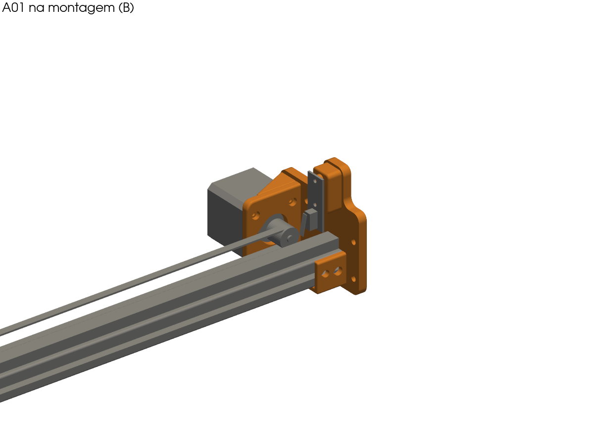

1. **Bloco do motor (A01):** porcas M3 nos bolsões do braço (por baixo). Motor na placa com 4 × M3×6 pela frente;
   polia GT2 no eixo do motor.
2. **Tensor (A02 + A04):** porca M5 autotravante no bolsão de trás do deslizador A04; porcas M3 e M4 pelos canais da
   frente; polia tensora no M5×20 com arruelas. Deslizador na prateleira do A02 (língua na canaleta).
3. **Perfil e trilho:** perfil 2020 + trilho MGN12 entre os dois blocos (escorregam em x até o pé). Prenda com M5×10
   + porca martelo na aba da frente e no piso de cada bloco. Use os **dois gabaritos A08** para centrar o trilho no
   perfil, aperte os M3 do trilho e retire os gabaritos.
4. **Carro (A05 + A07):** porcas M3 na placa (4 da carga por baixo, 4 das presilhas por cima). Placa no patim com
   4 × M3×6. Pontas da correia no canal da garra (dentes para baixo), presilhas A07 por baixo, 4 × M3×12.

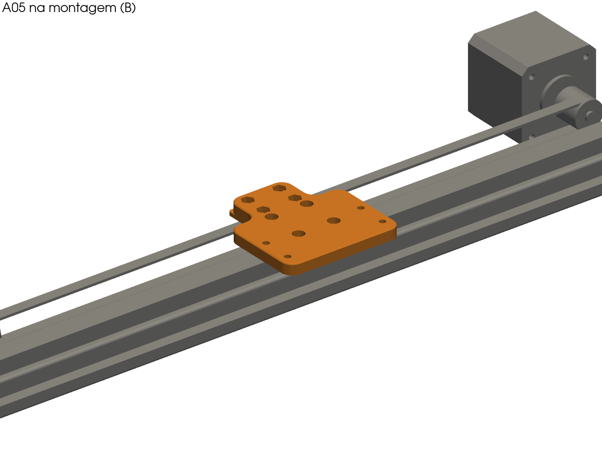

**Conferir:** o carro corre o trilho inteiro sem prender; a correia passa pela polia e pela tensora alinhada.

## Etapa 2 — Boca (no carro B)

**Imprimir:** `2_boca_e_soltura/` → A09.

1. LED IR333C e TIL78 nas buchas da boca (cola quente), fios para a esteira de cabos.
2. Boca na placa do carro B com 4 × M3×12 (nas porcas já embutidas na A05).

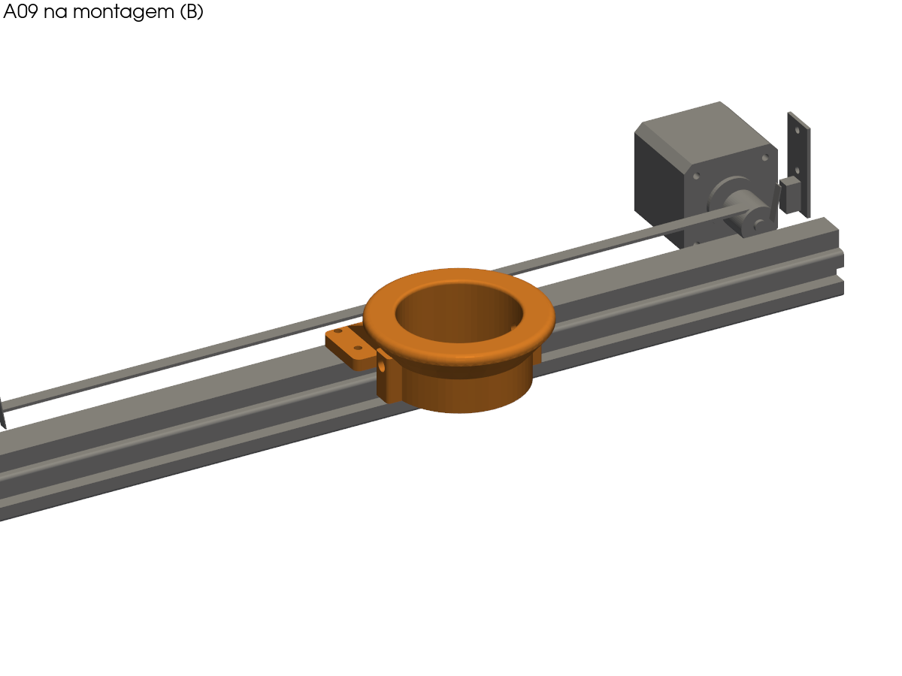

**Conferir:** a abertura é redonda Ø50 e a barreira IR fica 15 mm abaixo da face.

## Etapa 3 — Eixo A (de cima) e soltura, na bancada

**Imprimir:** `1_eixos/` → A01, A02, A04, A05, A07 (eixo A); `2_boca_e_soltura/` → A10, A11 (frente e trás), A36.

1. Monte o eixo A como na etapa 1 (as peças do eixo A são as versões "eixoA-cima"; o A01 do eixo A é **espelhado**
   — não troque com o do eixo B). O eixo A tem fim de curso só do lado do motor.
2. **Berço (A10 + A11):** porcas M3 nos bolsões dos eixos das portinholas. Engrene as duas portinholas **fechadas**
   (bordas internas juntas) e passe um M3×55 em cada eixo pelo berço.
3. Pino M3×25 na alavanca da portinhola de trás.
4. **Solenoide:** garfo A36 no êmbolo, travado com pino M2×12 (ou arame Ø2); o rasgo do garfo abraça o pino da
   alavanca. Solenoide na bochecha do lado do motor com 2 × M3×6 nos rasgos — ajuste a altura com as portinholas
   fechadas.
5. Berço na placa do carro A com 3 × M3×12.

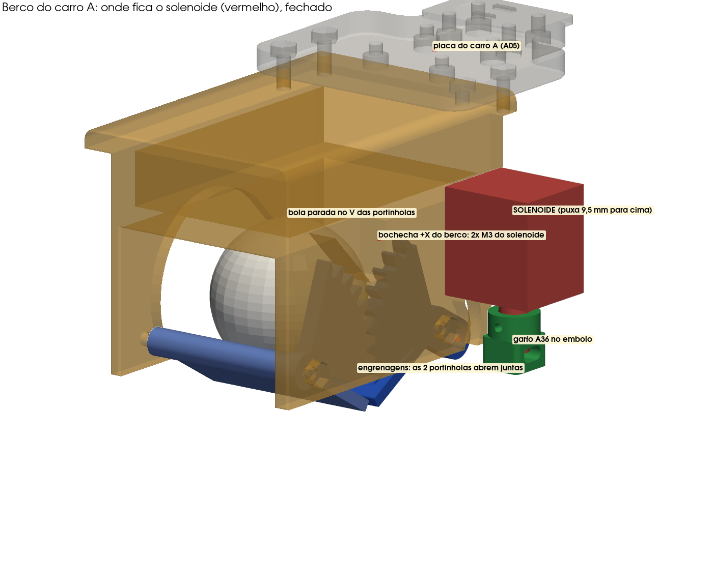

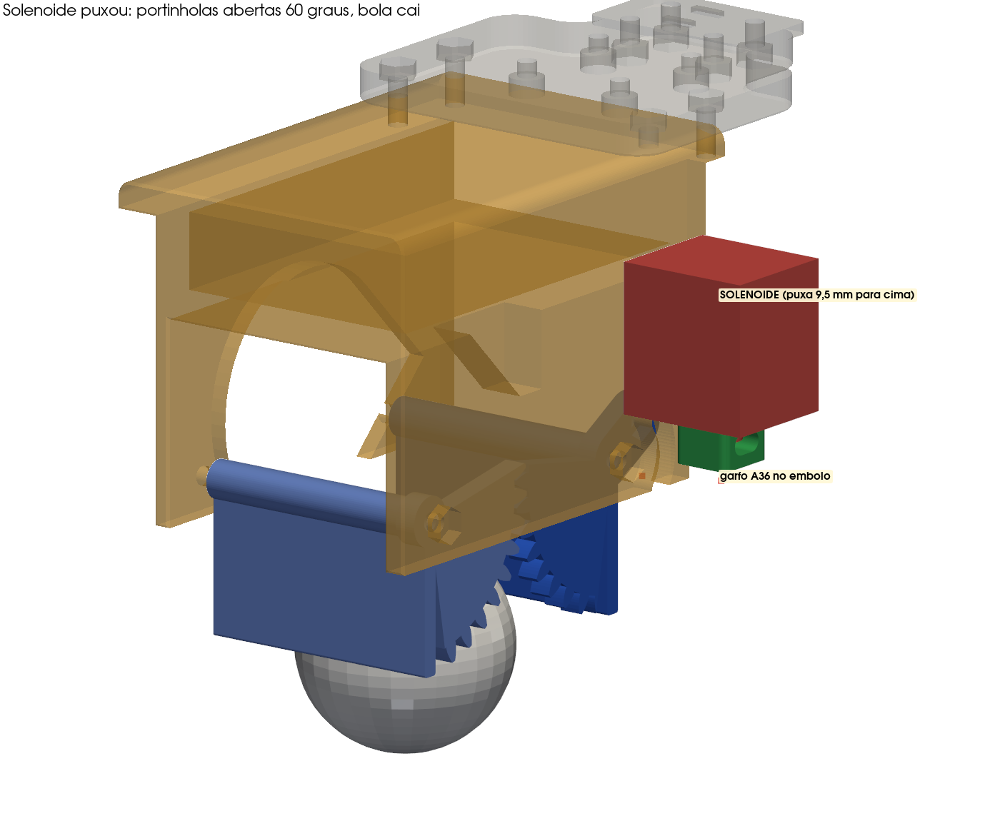

**Conferir:** com o solenoide desligado a bola fica no berço; ligado por 50 ms, as duas portinholas abrem iguais e a
bola cai reta. Se a bola abrir as portinholas sozinha, ponha uma mola de tração pequena entre o garfo e a bochecha.

## Etapa 4 — Eixos no gabinete

1. Eixo B na altura z = 1175 (meio do trilho), eixo A em z = 1530: cada bloco com 4 × M4×25 nas porcas-garra.
2. **Tensionar a correia:** M4×40 por fora da lateral esquerda até a porca do deslizador A04; aperte até tensionar
   e trave com o M3×12 por baixo.
3. Módulos de fim de curso: 2 × M3×12 em cada um (eixo B nos dois lados; eixo A só do lado do motor).

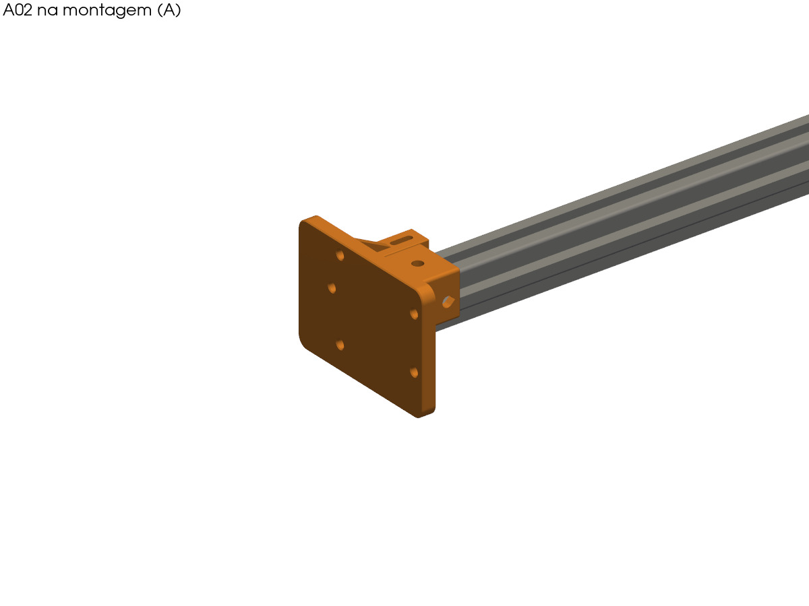

**Conferir:** a placa do carro aciona o fim de curso antes de encostar no bloco (folga mínima de 1 mm no fim do
curso); o carro A para em x = −141 do lado do tensor (limite no firmware).

## Etapa 5 — Pé do elevador (antes da bandeja)

**Imprimir:** `5_elevador/` → A20, A24.

1. Prense um 608ZZ de cima no fundo do rebaixo da A20.
2. Segure a A20 por baixo da divisória (furo Ø101) e parafuse **de cima** com 3 parafusos de madeira 3,5×30 cabeça
   chata (escareie a divisória). Isso tem de ser feito **antes da bandeja**.
3. **Motor:** NEMA 17 na placa da A24 com 4 × M3×8 por dentro da gaiola; acoplamento 5×8 no eixo do motor.
   A A24 vai na A20 só na etapa 7, quando a barra M8 já estiver no lugar.

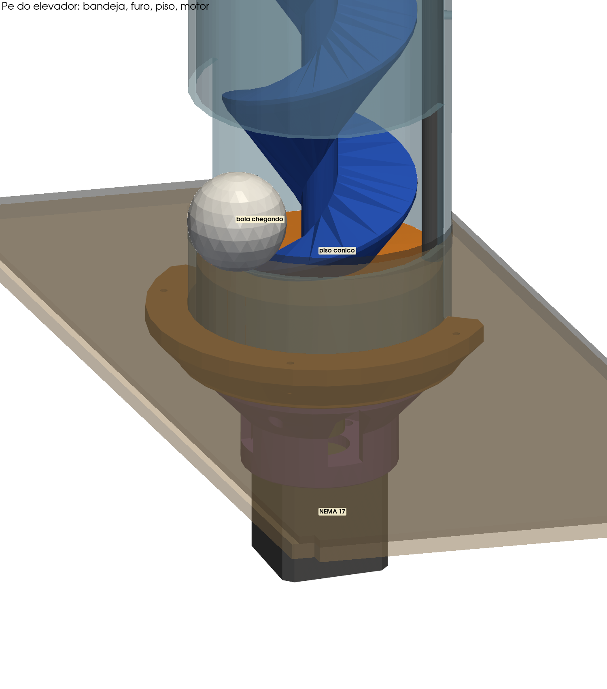

## Etapa 6 — Bandeja

**Imprimir:** `4_bandeja/` → A12 (6 calços, alturas diferentes), A13 (2 rodapés iguais).

1. Marque a posição dos 6 calços na divisória (use a placa de MDF como gabarito). Cada calço tem a altura no nome do
   arquivo e a posição: frente-esquerda, trás-esquerda, frente-centro, trás-centro, frente-centro-direita, trás-direita.
2. Rodapés A13 na placa de MDF **antes do EVA**: 3 parafusos de madeira 3,5×12 pela aba de cada metade.
3. Placa sobre os calços, parafuso de madeira 3,5×40 de cima atravessando placa e calço.
4. EVA por cima, encostado nos rodapés, com o furo do tubo e os recortes dos cantos.

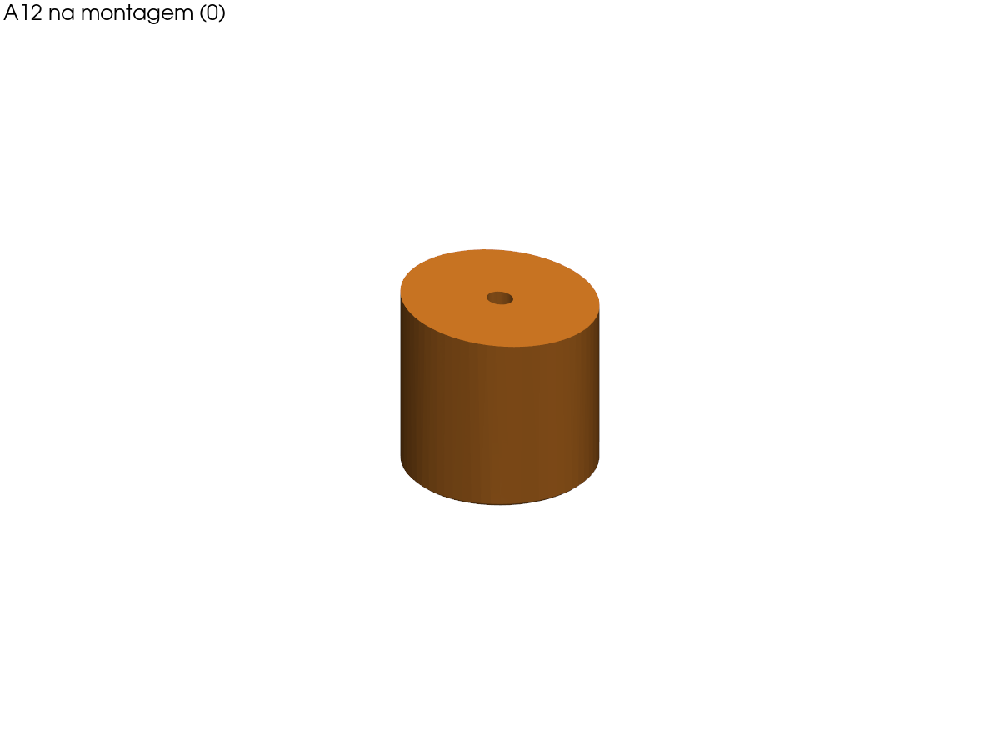

**Conferir:** a bandeja desce para o canto frente-direita (3,5° em x e 3° em y); uma bola solta em qualquer ponto
rola até o tubo do elevador.

## Etapa 7 — Elevador

**Imprimir:** `5_elevador/` → A21 (segmentos 1, 2 e 3), A27, A25, A22, A23.
A A27 imprime em pé, com o colar na mesa e **brim de 8 mm**.

1. **Na bancada — tubo:** trilho de alumínio Ø8 aparafusado no acrílico Ø100 com 2 × M3×8 (z = 1200 e 1400), com a
   ponta 3 mm acima do topo do acrílico. Encaixe a cabeça A27 por cima: colar por fora do acrílico e ponta do
   trilho no encaixe da flange.
2. **Na bancada — fuso:** porca + arruela na barra M8 na altura do rebaixo da A20; segmentos 1, 2 e 3 com 2 pinos
   Ø3×16 em cada junta (a hélice continua); arruela + porca em cima, apertado.
3. Desça o tubo (com a A27) pelo furo da bandeja e da divisória até o ressalto da A20, trilho no encaixe do piso.
4. Desça o fuso pelo topo até apoiar no rolamento de baixo.
5. **Motor:** suba o conjunto A24 + motor até a A20, barra M8 entrando no acoplamento; 4 × M3×20 de baixo; aperte o
   acoplamento na barra pela janela da gaiola.
6. **Saída e tampa:** porcas M3 nos rasgos dos postes da A25; encaixe a borda do piso da A25 na janela da A27.
   Prense o 608 na tampa A22 (por baixo), assente a tampa no topo (barra no 608) e prenda a saída com 2 × M3×20 de
   cima. Tampa na lateral direita com 2 × M4×30 de fora (porca por dentro). Porca M8 por cima do 608.

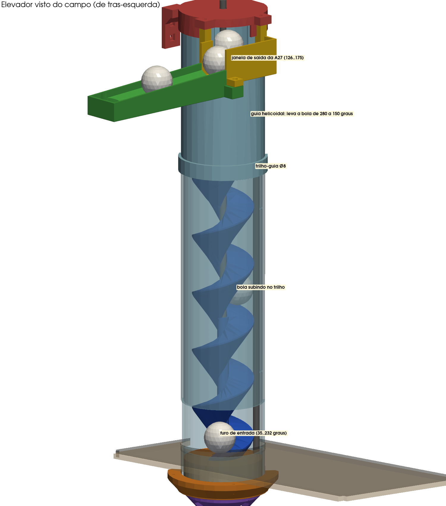

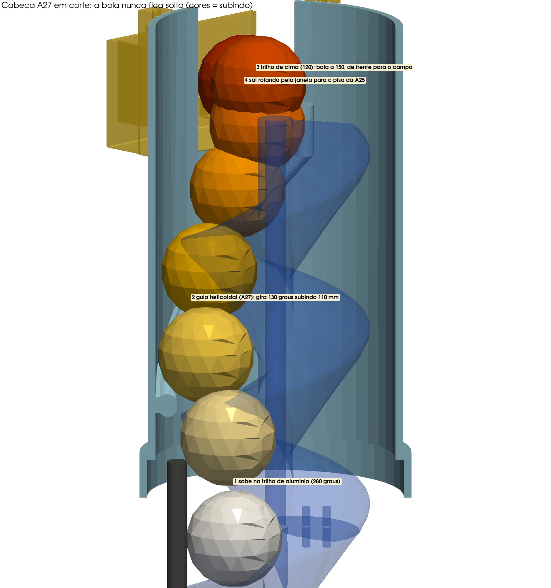

**Conferir:** o fuso gira **no sentido horário visto de cima**, a até 30 rpm, sem raspar no tubo; uma bola posta pelo
furo do pé sobe encostada no trilho, passa pela guia da A27 e sai rolando pela janela.

## Etapa 8 — Magazine e carga do berço

**Imprimir:** `3_magazine_e_carga/` → A19, A18, A15, A16, A17, A26.

1. **Entrada:** A19 na lateral direita com 2 × M4×25; porcas M3 pelos rasgos do fundo da A18; tubo Ø50 encaixado na
   A18; A18 apoiada na A19 e presa por baixo com 2 × M3×12.
2. **Saída e curva:** pinos Ø4 na junta da A15; A15 na lateral esquerda com 2 × M4×25; encaixe a outra ponta do tubo.
3. **Escapamento (A16 + A17):** servo SG90 entre os postes da A16, encostado na lateral, com os 2 parafusos das
   orelhas. Braço do servo no rebaixo do balancim A17, parafuso do braço pelo centro + 2 × M2×6. **Monte o
   balancim com o servo em 90°** (dedos nivelados). Pinos Ø4 na junta com a A15; A16 na lateral esquerda com 2 × M4×25.
4. **Entrada do berço (A26):** pinos Ø4 na junta com a A16; A26 na lateral esquerda com 2 × M4×25.

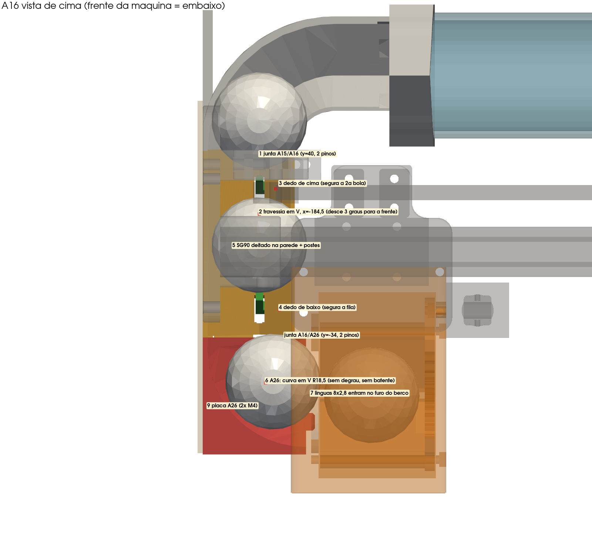

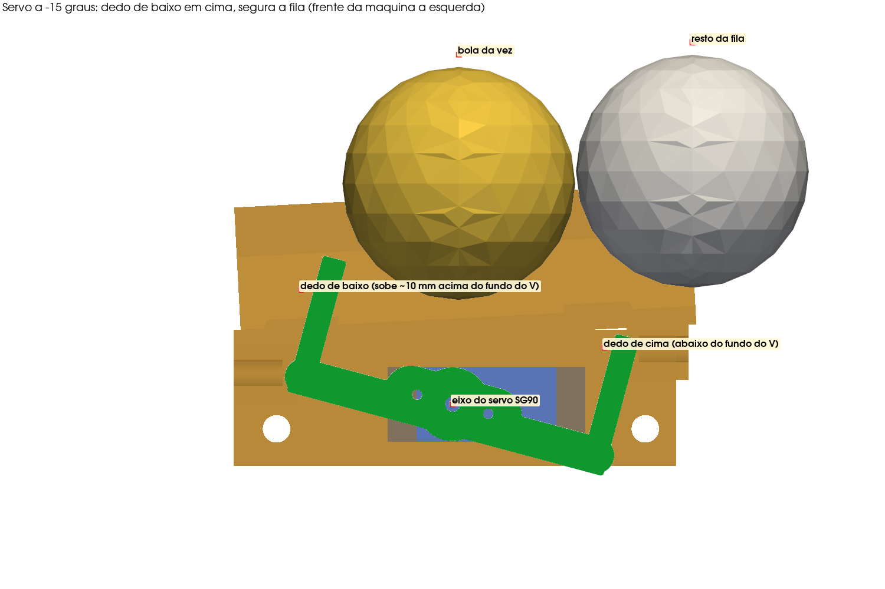

**Conferir:**
- Com o carro A parado na carga (x = −140), as línguas da A26 entram no furo do berço **sem encostar**
  (1,3 mm de folga no raio).
- Servo em −15°: o dedo de baixo segura a fila. Em +15°: o dedo de cima segura a segunda bola e só a primeira sai.
- O balancim não raspa na A16 em nenhuma posição (folga de 0,8 mm).

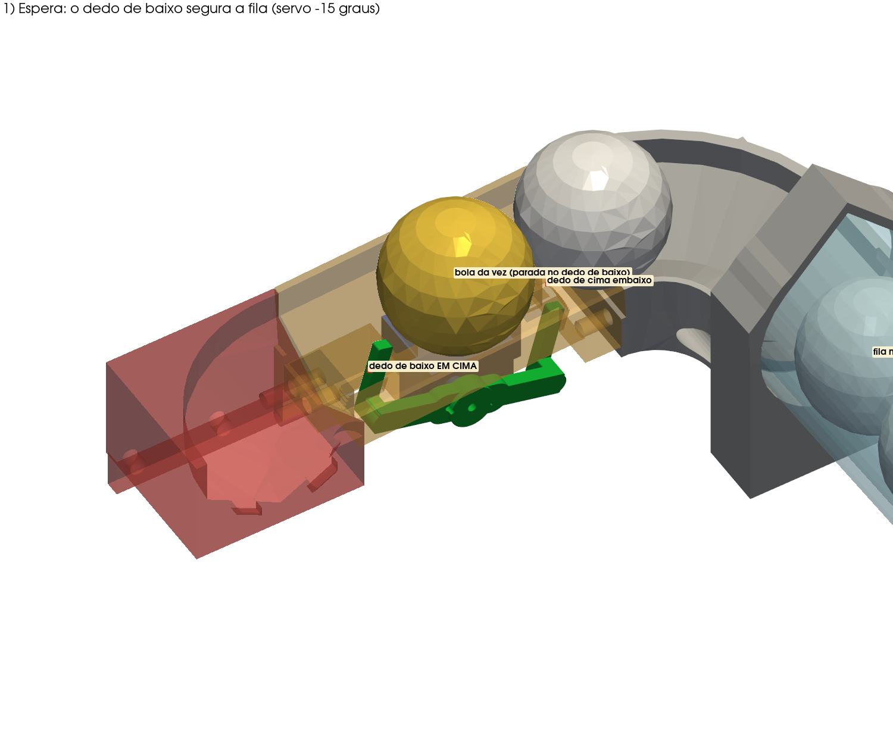
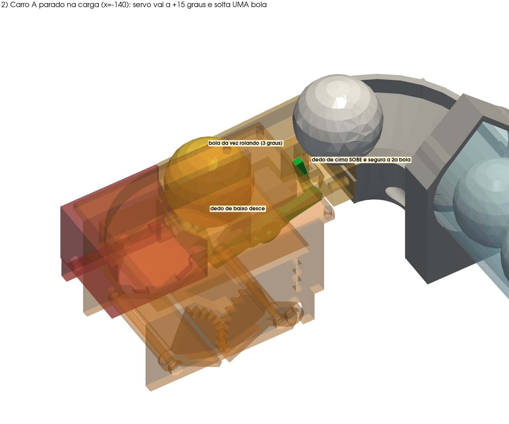
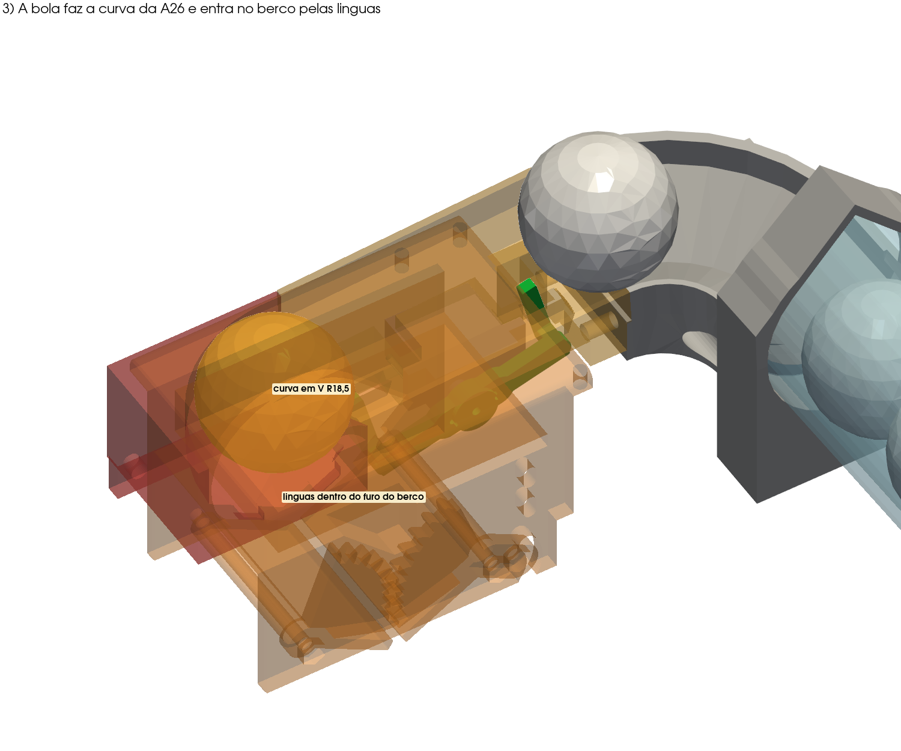
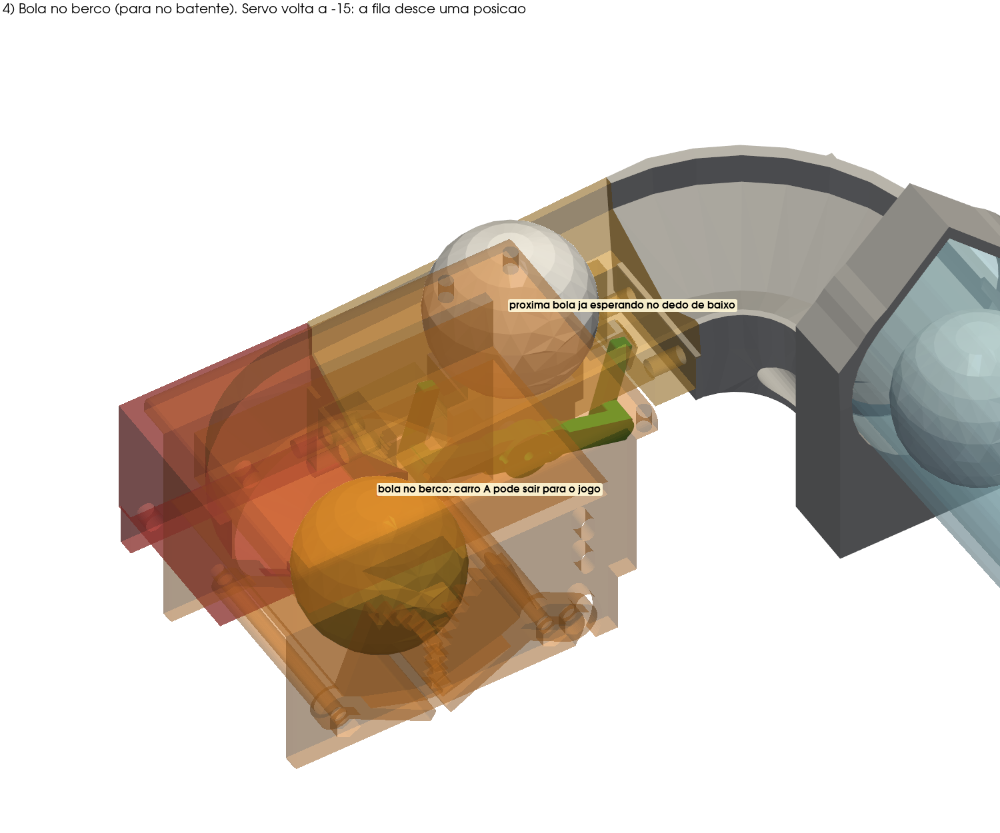

## Etapa 9 — Calha do elevador até o magazine

1. Porcas M3 nos bolsões de baixo das orelhas da A23.
2. Apoie o fundo da A23 na borda do funil da A18, com as orelhas por baixo da saída A25.
3. 2 × M3×16 de cima, pela A25.

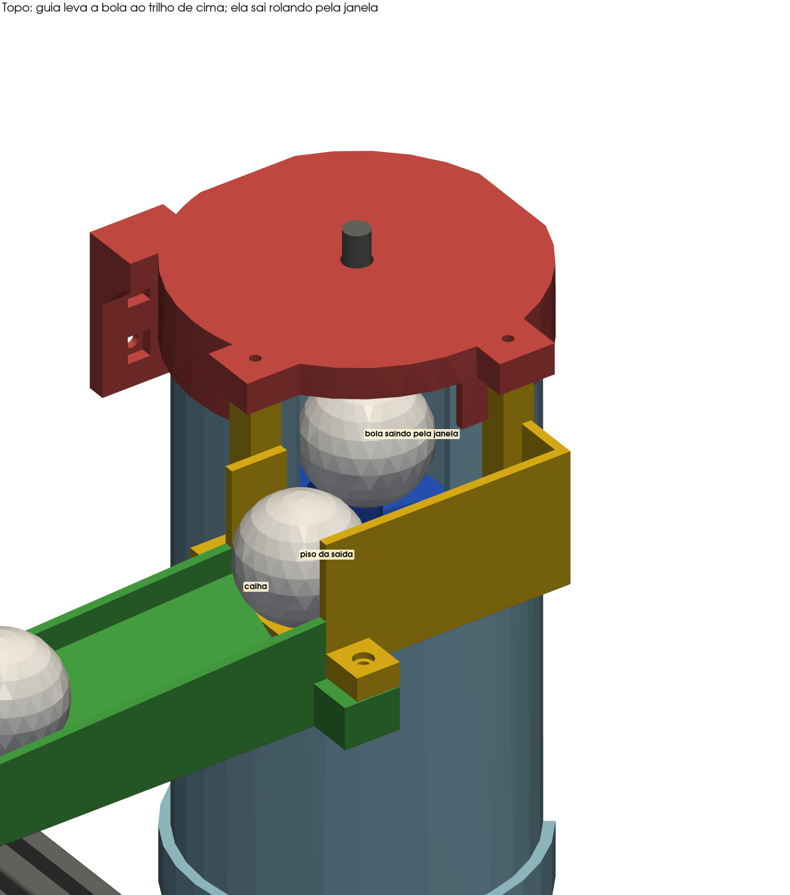

**Conferir:** a bola que sai do elevador desce a calha (3°) e cai pelo furo dentro do funil da A18.

## Etapa 10 — Teste completo

Faça na ordem; cada um depende do anterior.

1. **Bandeja:** solte bolas em pontos diferentes; todas chegam ao tubo. Se pararem no EVA, troque por EVA de 1 mm
   ou feltro fino (a inclinação não tem margem para aumentar).
2. **Elevador, pé:** bolas paradas nas duas cunhas (encostadas no tubo junto da parede direita e da frente) caem para
   dentro; nenhuma prende na borda do furo com o fuso girando.
3. **Elevador, topo:** 20 bolas seguidas saem pela janela sem voltar para baixo.
4. **Magazine:** 10 bolas na fila; o escapamento solta uma por vez.
5. **Carga:** com o carro A na carga, a bola passa a curva da A26 e para no batente do berço.
6. **Soltura:** 20 soltas sobre uma folha marcada 250 mm abaixo; o espalhamento das marcas é a dispersão da máquina.
7. **Ciclo completo:** jogar até o magazine esvaziar e reabastecer pelo elevador.

Anote os resultados e as medidas reais em [PENDENCIAS.md](PENDENCIAS.md) — é isso que transforma valor estimado em
valor medido.

---

### O que este guia ainda não cobre

- **Cabos:** a esteira de cabos dos carros e o caminho dos fios não estão modelados.
- **Eletrônica:** placa, drivers e fonte seguem a página `/montagem` do site.
- **Gabinete:** as peças de MDF seguem o projeto do gabinete; aqui só a furação nova.
