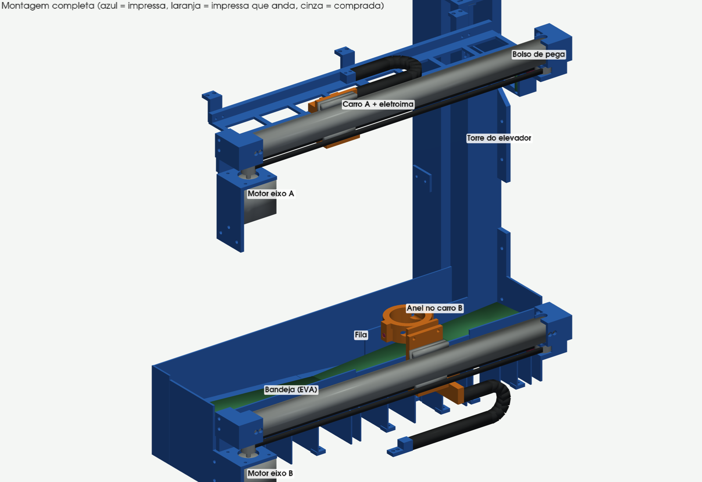
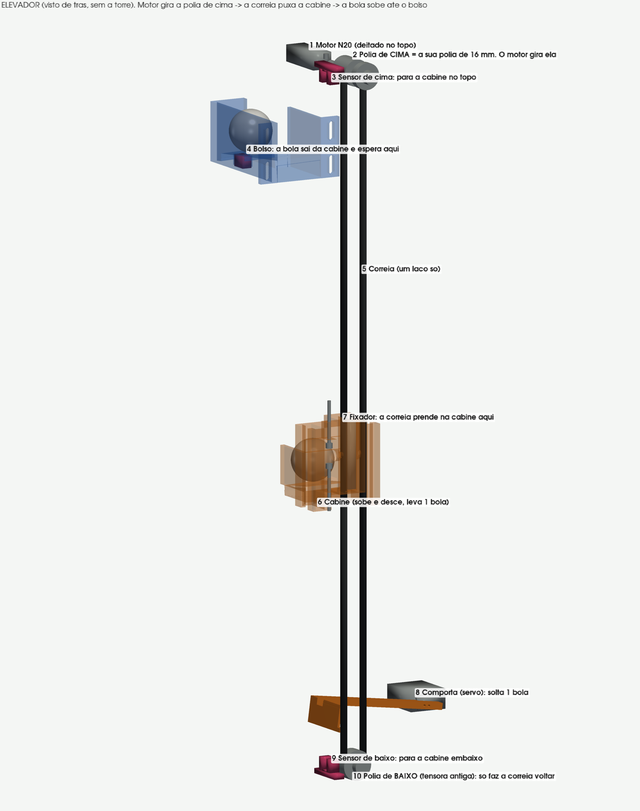

# PICBOX compacta (R2.2)

Máquina A inteira dentro do gabinete de **440 × 430 × 230** livres (tela no fundo), bola de aço de 1" (25,4 mm, 67 g).

<p align="center"></p>

## Pastas

| Pasta / arquivo | Para que serve |
|---|---|
| `imprimir/LEIA-ME_R2.txt` | **Comece aqui.** O que mudou na R2 (gabinete novo, torre do elevador em 2 peças, polia de cima R2.2) e o que comprar. |
| `imprimir/ORDEM_DE_IMPRESSAO.txt` | Mesas por impressora, na ordem. `PICBOX_compacta_impressao.html` mostra a mesma coisa com imagem de cada mesa. |
| `imprimir/A_impressora_grande/` | Impressora boa (260 × 260): peças de precisão e as que ficam à vista. |
| `imprimir/B_creality_1/`, `imprimir/C_creality_2/` | Creality (220 × 220): peças grandes e simples. |
| `imprimir/SparkX_i7/` + `PICBOX_R2_SparkX_i7.html` | Tudo numa impressora só (SparkX i7, 260 × 260), no menor número de mesas. |
| `imprimir/polia_de_cima/` | **R2.2:** adaptador N20→M5, espaçador e arruela da polia de cima (~25 min, 100%), com `LEIA.txt` e as imagens da montagem. |
| `imprimir/pecas_avulsas/` | Uma STL por peça, para reimprimir só uma. `__x2` no nome = imprimir 2 cópias. |
| `imprimir/PICBOX_R2_completa.zip` | Tudo de `imprimir/` num zip só. |
| `pagina/PICBOX_compacta_visualizacao.html` | 3D da máquina, cada peça explicada, montagem passo a passo, cabos, firmware e checagens. |
| `pagina/PICBOX_R2_visualizador_3D.html` | Visualizador 3D de arquivo único: cada peça, onde fica na mesa de impressão e em que passo entra. |
| `pagina/PICBOX_elevador_3D.html` | **Elevador em 3D** com o nome de cada peça e a cabine subindo e descendo. |
| `pagina/PICBOX_elevador_montagem.html` | **Montagem do elevador em 15 passos**, com as peças entrando no lugar. |
| `pagina/PICBOX_como_funciona.html` | Como funciona, animado: elevador, correias, bolso, anel e sensores. |
| `pagina/PICBOX_bucha_polia_n20.html` | Bucha da polia do N20 (não é mais usada desde a R2; fica como referência). |
| `imagens/` | Imagens com as peças reais: geral (01–10), elevador (`e1`), polias (`p1`–`p5`), sensores (`s1`–`s7`). |
| `step/` | Cada peça na posição de montagem, para abrir num CAD e editar. |
| `cad/` | Código que gera tudo. Só precisa abrir para mudar o projeto. |

Abra os `.html` direto no navegador. Eles são de arquivo único e podem ser enviados para outras pessoas.

## Como funciona

1. **Fila:** as bolas esperam numa calha no fundo, embaixo.
2. **Comporta:** um servo SG90 deixa passar uma bola por vez para a cabine do elevador.
3. **Elevador:** o motor N20 (100 rpm) gira a polia de cima e a correia GT2 puxa a cabine nos trilhos da torre (~67 mm/s, 342 mm de curso). Os sensores de fenda param a cabine embaixo e em cima. No topo, a bola rola pela rampa até o bolso.
4. **Pega:** o carro A, no trilho de cima, para sobre o bolso e o eletroímã segura a bola. O sensor do bolso confirma a pega.
5. **Jogo:** o botão desliga o ímã e a bola cai até o anel do carro B. A barreira infravermelha conta o acerto.
6. **Volta:** a bola cai na bandeja com EVA e rola até a fila.

<p align="center"></p>

## Elevador (R2.2)

- **Torre em 2 peças impressas:** a de baixo (pé, trilhos, polia de baixo, sensor de baixo) e a de cima (berço do N20, polia de cima, sensor de cima, pilares da rampa). Encaixam por 3 pinos e 4 M3x8.
- **Polia de cima:** a polia GT2 20T de 16 mm num parafuso M5x45 com 1 rolamento 625ZZ atrás. O N20 gira o M5 por um adaptador impresso. **Na torre de cima já impressa, corte a tira do teto (4,5 mm) entre o encaixe da frente e a janela.**
- **Correia:** um laço só, com as 2 pontas no fixador de alumínio atrás da cabine. Estica puxando a polia de baixo no rasgo.
- Passo a passo: `pagina/PICBOX_elevador_montagem.html` e `imprimir/polia_de_cima/LEIA.txt`.

## Para regerar tudo (se mudar o projeto)

De dentro de `cad/maquina/`, **pelo PowerShell** (o `pecas.py` usa CadQuery):

```
python regerar.py
```

Ele roda, nesta ordem, e para no primeiro erro:

1. `checagem`
2. `resistencia_m`
3. `pecas`
4. `teste_stl`
5. `plano`
6. `plano_unica`
7. `malhas`
8. `render_m`, `render_polias`, `render_sensores`, `render_elevador`, `render_mesas`
9. `impressao_html`
10. `explica_html`
11. `pagina_m`
12. `publicar`

Para continuar de um passo: `python regerar.py malhas`.

`publicar.py` **apaga e recria** `imprimir/`, `pagina/`, `imagens/` e `step/`. Ele também gera a polia de cima, a ficha da SparkX i7, o zip, o visualizador, o elevador 3D e a montagem do elevador. Tudo o que fica nessas pastas precisa sair do pipeline.
