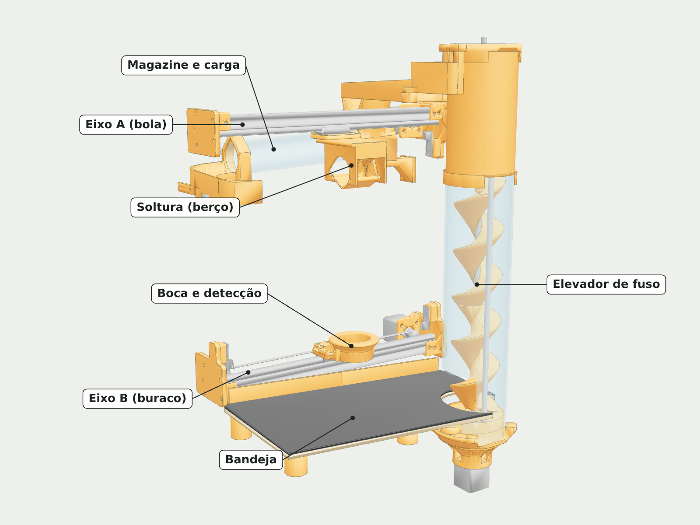
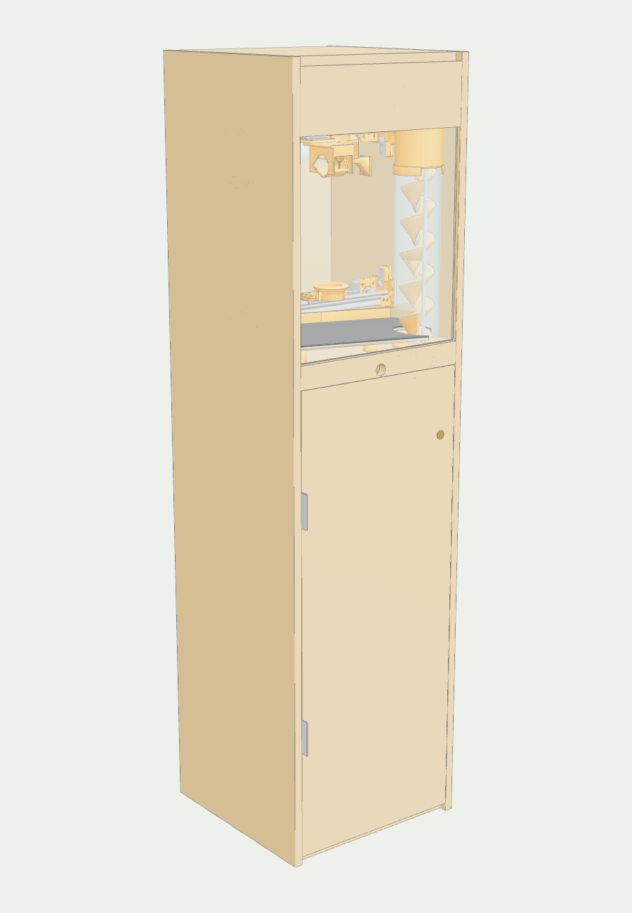
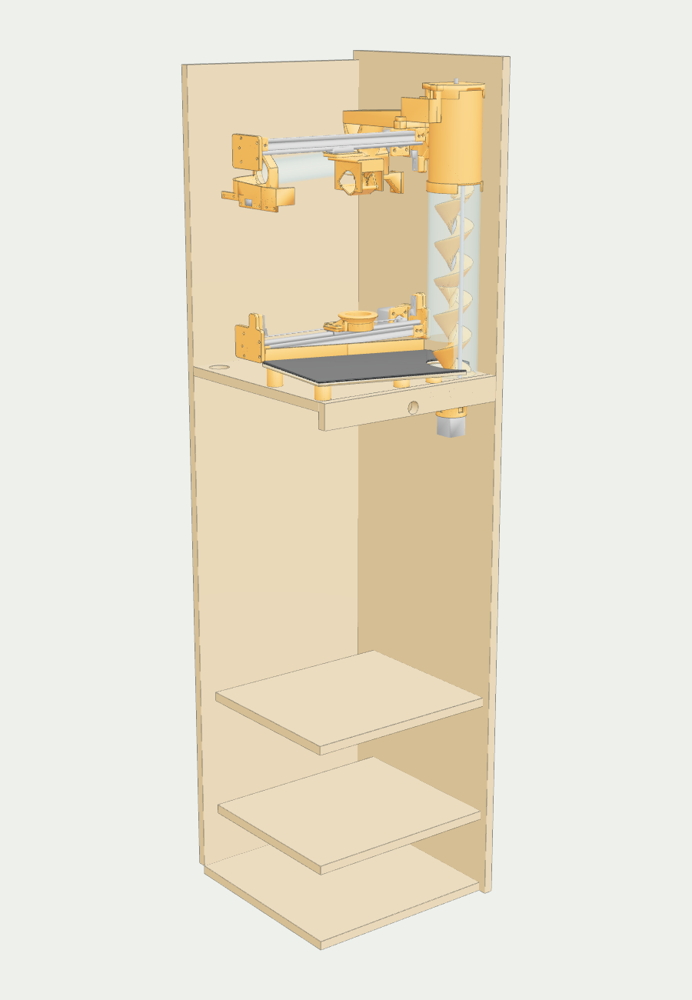
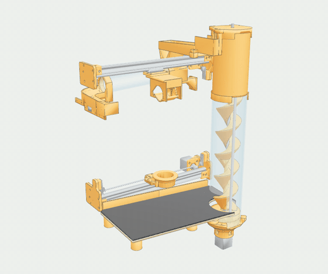
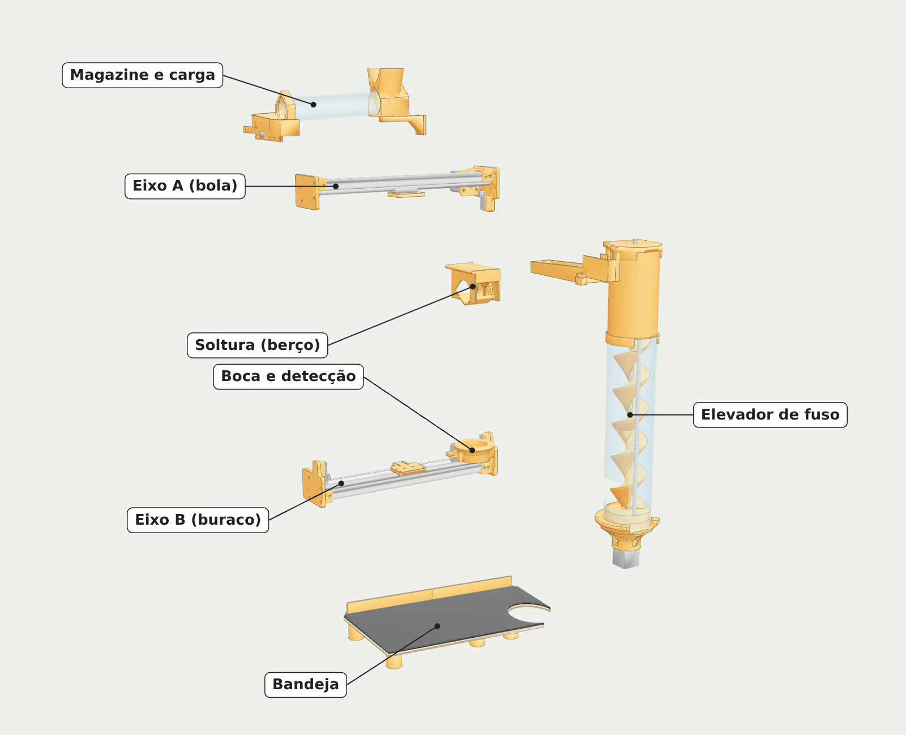
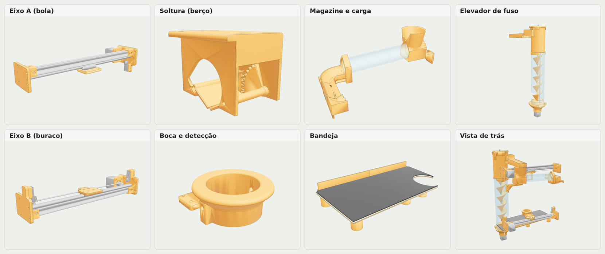

# PICBOX normal

Versão original da Máquina A: gabinete de 450 × 450 × 1700, bola de 38 mm. Não é a que está sendo impressa agora (essa é a `compacta`).

| Pasta | Para que serve |
|---|---|
| `cad/` | CAD das peças em CadQuery (A01 a A36). As STLs ficam em `cad/saidas/stl_para_imprimir/`, por grupo. Veja `cad/README.md`. |
| `docs/` | Documentos de projeto: `PROJETO.md`, `ENGENHARIA.md` e `ESPECIFICACAO_CAD_PECAS.md`. |
| `simulacao/` | O simulador do site (física, jogo, economia e o modelo 3D). O site no ar é publicado do ramo `main`. |

## A máquina A inteira

  

| Gabinete fechado | Gabinete aberto |
|:---:|:---:|
|  |  |
| 450 × 450 × 1700 mm, MDF 18 | campo de jogo em cima; o pedestal fica para fonte e eletrônica |

O gabinete vem do CAD antigo e entra só como contexto. Todo o resto é o CadQuery de `cad/`: as 39 peças impressas
(42 unidades), as compradas e a bandeja.

**Em movimento** (sem gabinete):

**Vista explodida** (cada módulo afastado da posição real):

**Módulo a módulo:**

Para girar e clicar nas peças, abra `cad/saidas/visualizador.html`. As imagens acima saem de
`cad/ferramentas/visao_geral/gerar.py`; rode de novo depois do `build_all.py` quando o CAD mudar.
